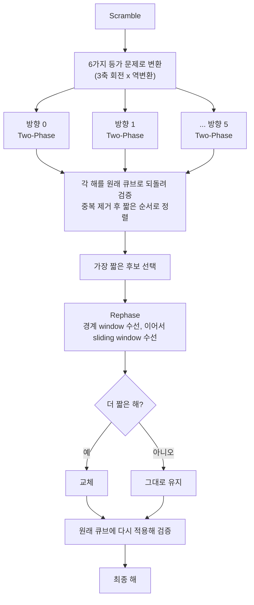

# Cube Solver Dev

Kociemba two-phase로 푼 해를 **정확 검색으로 한 번 더 다듬는(rephase)** Cube Solver 실험 프로젝트이다.

> **English summary.** Rubik's Cube solvers built around Kociemba's two-phase algorithm, plus a post-processing step called *rephase*: windows around the phase boundary (then sliding over the whole solution) are re-solved exactly, and a window is replaced only if a strictly shorter equivalent sequence exists — so the move count never grows. `rephase/` is a Python/C version on top of the pip `kociemba` solver; `stemil-rephase/` is a C++ version on top of the third-party [stemil two-phase-solver](https://github.com/stemil01/two-phase-solver), extended with 6-way orientation search and an exact (IDA\*) reference solver. On 200 scrambles where rephase actually helped, the 6-way solver averages **17.52** moves vs 20.05 (stemil), 20.89 (kociemba) and ~20.6 (kociemba + symmetry), and equals a proven lower bound (= optimal) in 85/200 cases. Third-party code is **not** included — see [NOTICE.md](NOTICE.md).

<details>
<summary>목차</summary>

1. [프로젝트 소개](#1-프로젝트-소개)
2. [저장소 구성](#2-저장소-구성)
3. [개발 환경](#3-개발-환경)
4. [시작하기](#4-시작하기)
5. [동작 원리](#5-동작-원리)
6. [실험 결과](#6-실험-결과)
7. [만난 문제와 해결](#7-만난-문제와-해결)
8. [한계와 앞으로](#8-한계와-앞으로)
9. [출처와 라이선스](#9-출처와-라이선스)

</details>

---

## 1. 프로젝트 소개

### 1.1 만든 이유

Kociemba two-phase는 큐브를 두 단계로 푼다. Phase 1에서 G1이라는 부분군까지 간 뒤, Phase 2에서 그 안에서만 움직여 맞춘다. 문제는 Phase 1이 끝나는 순간 **반드시 G1 조건을 만족해야 한다**는 점이다. 전체 최단 경로가 G1을 지나갈 필요는 없으므로, 두 단계가 만나는 경계 근처에서 수가 조금씩 낭비될 수 있다고 보았다.

그래서 다음과 같은 후처리를 만들었다.

1. Two-Phase로 해를 구하고 Phase 경계의 위치를 기록한다.
2. 경계 주변의 짧은 구간(window)을 잘라, 같은 변환을 만드는 **더 짧은 수순**이 있는지 정확하게 검색한다.
3. 있으면 바꿔 끼우고, 없으면 그대로 둔다. 더 짧을 때만 바뀌므로 **수가 늘어나는 일은 없다.**
4. 경계 수선이 끝나면 해 전체를 window로 훑으며(sliding) 같은 검사를 한다.

이 후처리를 **rephase**라고 부른다. 자세한 설계는 [docs/design.md](docs/design.md)에 있다.

### 1.2 구현한 것

| 구현 | 설명 |
|---|---|
| [`rephase/`](rephase) | pip `kociemba` 위에 올린 Python/C 구현. Phase 경계 수선 |
| [`stemil-rephase/`](stemil-rephase) — **기본판** `stemil_rephase` | 외부 Solver [stemil](https://github.com/stemil01/two-phase-solver)(큰 pruning table) 위에 올린 C++ 구현. 단일 스레드로 stemil을 풀고 경계·sliding rephase를 적용한다 |
| [`stemil-rephase/`](stemil-rephase) — **확장판** `stemil_rephase_6way` | 기본판에 **6방향 동시 탐색**, 후보 rephase, `--phase1-mode ida`, 최적해(IDA\*) 검증기, 비교 실험 도구를 더한 것이다 |
| [`benchmarks/`](benchmarks) | 같은 seed 200건 비교 결과와 이전 실험 기록 |

> **용어.** `stemil_rephase`는 기본판이고 `stemil_rephase_6way`는 그 확장판이다. 이 저장소에서는 두 버전이 `stemil-rephase/` 한 폴더, **같은 바이너리**에 들어 있고 옵션으로 구분한다. 확장 옵션을 끄면(`--orientations 1 --candidates 1`, 기본값) 기본판과 같은 경로로 동작한다. 아래 결과표의 **6way**는 `--orientations 6 --candidates 1 --phase1-mode ida --windows 8` 조합, 곧 확장판을 가리킨다.

### 1.3 한눈에 보는 결과

rephase가 해를 실제로 줄인 큐브 200개로 비교했다(자세한 조건은 [6장](#6-실험-결과)).

| 알고리즘 | 평균 move | 메모리 |
|---|---:|---:|
| **6way + rephase** (`stemil_rephase_6way`, 이 프로젝트) | **17.52** | 2,097 MiB |
| stemil (원본) | 20.05 | 2,090 MiB |
| kociemba (pip, C) | 20.89 | 20 MiB |
| kociemba + symmetry | 20.55 | 113 MiB |

6way의 결과가 증명된 하한과 같아서 **최적해로 확정되는 큐브가 200개 중 85개(42.5%)** 였다.

---

## 2. 저장소 구성

이 폴더에서 **직접 만든 것**과 **다른 사람이 만든 원본**은 다음과 같이 나뉜다.

```
Cube-Solver-Dev/
├── README.md
├── NOTICE.md                  # 출처 구분 표 (원본 / 파생 / 내 작업)
├── docs/
│   └── design.md              # 설계 노트
├── rephase/                   # ✅ 내 작업 — Python/C, Kociemba + 경계 수선
│   ├── boundary_repair/       #    수선 엔진 (cube, exact search, backends)
│   ├── repeat_metrics/        #    반복 실행·계측
│   ├── tests/  examples/
│   └── solve.py  repeat_solve.py  benchmark.py
├── stemil-rephase/            # ✅ 내 작업 — C++, 기본판과 6way 확장판이 한 바이너리
│   ├── src/                   #    repair · solver(기본판) / solver(solve_multi)·symmetry·optimal(6way 확장) · kernel
│   ├── tests/  tools/
│   ├── compare/               #    [6way] 같은 seed 비교 도구 (stemil_orig.cpp는 파생 코드)
│   ├── corpus/                #    최적해를 아는 큐브 모음
│   ├── README.md  REPORT.md   #    기본판 설명·측정
│   ├── README-6way.md  REPORT-6way.md   # 6way 확장판 설명·측정
│   └── Makefile
├── benchmarks/                # ✅ 내 작업 — 실험 결과
│   ├── compare-200/           #    200건 비교 (CSV, JSONL, summary.txt)
│   └── earlier/               #    이전 실험 기록
└── third_party/
    └── stemil/                # ⛔ 다른 사람 코드 — git submodule, 출처 https://github.com/stemil01/two-phase-solver (커밋 5437b8f), 수정하지 않음
```

stemil, Kociemba two-phase 알고리즘, pip `kociemba`, `RubikTwoPhase`는 모두 다른 사람이 만든 원본이다. 코드를 이 저장소로 복사하지 않고 submodule이나 의존성으로만 연결했다. 자세한 내용은 [NOTICE.md](NOTICE.md)에 정리했다.

---

## 3. 개발 환경

| 구분 | 내용 |
|---|---|
| 언어 | C++17 (`g++ 13.3`, `-O3`), Python 3.12 |
| OS / 장비 | WSL2 (Ubuntu 24.04), Intel Core i5-1235U (12 스레드), RAM 약 8 GB |
| 외부 Solver | stemil two-phase-solver (submodule, 커밋 `5437b8f`) |
| Python 의존성 | `kociemba==1.2.1`, `RubikTwoPhase==1.1.1` (비교용) |
| 디스크 / 메모리 | stemil의 pruning table은 파일로 약 6 GB, 실행 중에는 약 2 GiB RAM |

> pruning table은 크기 때문에 저장소에 넣지 않았다. 만드는 방법은 [시작하기](#4-시작하기)에 있다.

---

## 4. 시작하기

### 4.1 내려받기

```bash
git clone --recursive https://github.com/P0doDang/PodoDang-suGar
cd PodoDang-suGar/Cube-Solver-Dev
```

`--recursive`를 빼먹었다면 `git submodule update --init`을 한 번 실행한다.

### 4.2 rephase (Python)

```bash
cd rephase
python3 -m venv .venv
.venv/bin/python -m pip install -r requirements.txt

# 자동으로 20수 scramble을 만들어 풀고, 경계를 수선한다
.venv/bin/python solve.py solve --window 6 8 --time-ms 100 --trace
```

옵션은 [rephase/README.md](rephase/README.md)에 있다.

### 4.3 stemil-rephase (C++)

먼저 stemil([stemil01/two-phase-solver](https://github.com/stemil01/two-phase-solver))의 pruning table이 필요하다. **원본 README의 방법대로** `third_party/stemil`에서 한 번 만든다(약 6 GB 디스크, 시간이 오래 걸린다). 이 프로젝트의 프로그램은 테이블을 **읽기만** 하고 만들지는 않는다.

```bash
cd stemil-rephase
make -j4                       # build/ 아래에 stemil-rephase, optimal 등이 생긴다
make test && make test-cli     # 테스트
```

**기본판** (단일 스레드, 확장 옵션 없음) 예시이다.

```bash
./build/stemil-rephase solve --seed 659 --scramble-length 30 \
  --budget-ms 600 --rephase-ms 100 --windows 8
```

**6way 확장판** 예시이다. 30수 scramble을 6방향으로 풀고 rephase까지 적용한다.

```bash
./build/stemil-rephase solve --seed 659 --scramble-length 30 \
  --orientations 6 --phase1-mode ida \
  --budget-ms 600 --rephase-ms 100 --windows 8
```

- `--seed`: 같은 seed는 같은 scramble을 만든다 (탐색 결과는 시간 제한 때문에 조금씩 달라질 수 있다).
- `--budget-ms 600 --rephase-ms 100`: 전체 600 ms 중 Two-Phase가 500 ms, rephase가 최대 100 ms를 쓴다.
- 테이블을 다른 곳에 두었다면 `--resources <폴더>`로 지정한다.

기본판 옵션은 [stemil-rephase/README.md](stemil-rephase/README.md), 6way 확장 옵션은 [README-6way.md](stemil-rephase/README-6way.md)에 있다.

### 4.4 실제 사례

위 seed 659 큐브를 각 알고리즘이 푼 결과이다 (모두 직접 시뮬레이션으로 검증했다).

| 알고리즘 | 수 | 해 |
|---|---:|---|
| 6way + rephase | **17** | `R' F2 L2 F L2 F U' D2 B' L' F U R2 U' F2 B' D'` |
| 최적해 (IDA\*) | 17 | `R' F2 L2 F L2 F U' D2 B' L' F U R2 U' F2 B' D'` |
| stemil | 20 | `D L D' F D2 B L F R2 U D' F' R L2 U D2 B2 D2 L2 U'` |
| kociemba | 22 | `U R' D' L' F2 U F L' B2 D L2 B' U B2 U' R2 L2 U' L2 B2 L2 U'` |

scramble: `B2 D B' D2 R' B U2 R D' F2 U B2 U D' B D' F' D B D' B2 L2 B L2 U R2 L2 B' D2 R'`
6방향 탐색으로 얻은 18수 해를 rephase가 1수 줄여 17수가 되었고, 이 해는 최적해와 같다.

---

## 5. 동작 원리

6way Solver가 한 큐브를 푸는 흐름은 다음과 같다.



- 방향마다 Phase 1이 큐브의 서로 다른 면 축을 목표로 하므로, 같은 큐브라도 **서로 다른 후보 해**가 나온다. 방향은 스레드 하나씩 돌린다.
- rephase는 큐브 전체가 아니라 **가까운 두 상태 사이**만 검색한다. 짧은 수순의 변환을 미리 모아 둔 표(기본 반경 4)에서 한쪽을 찾고, 다른 쪽은 깊이 우선으로 탐색해 중간에서 만난다.
- 시간은 따로 정해 둔다. 이번 실험은 Two-Phase 500 ms + rephase 최대 100 ms였다.
- 마지막에는 **항상** 원래 큐브에 해를 적용해 풀리는지 확인한다. 실패하면 오류로 멈춘다.

---

## 6. 실험 결과

### 6.1 비교 방법

6way Solver로 seed를 하나씩 훑으며 **rephase가 해를 실제로 줄인 큐브**만 모았다. 82,224개를 훑어 200건이 모였다(약 0.24%). 그 200개 scramble(30수)을 아래 알고리즘이 똑같이 풀었다.

- **6way** (`stemil_rephase_6way`): 6방향, 후보 1, `--phase1-mode ida`, Two-Phase 500 ms + rephase ≤ 100 ms, window 8
- **stemil**: 원본 탐색 500 ms
- **kociemba**: pip 패키지(C), 첫 해 반환
- **kociemba + symmetry**: `RubikTwoPhase`(Python), 첫 해 반환
- **최적해**: IDA\*, 큐브당 60초 상한, 6스레드

테이블 로딩 시간은 모두 제외했다. 메모리는 프로세스 peak RSS이다.

### 6.2 결과

| 알고리즘 | 평균 move | time_to_final (ms) | wall (ms) | peak 메모리 (MiB) |
|---|---:|---:|---:|---:|
| **6way + rephase** | **17.52** | 144.2 | 508.5 | 2097.1 |
| stemil (원본) | 20.05 | 55.6 | 500.1 | 2090.2 |
| kociemba (pip, C) | 20.89 | 22.8 | 22.8 | 19.8 |
| kociemba + symmetry | 20.55 | 20.1 | 20.1 | 113.2 |
| 최적해 (확정된 35건만) | 16.51 | 27,839 | 54,374 | 2523.1 |

- `time_to_final`: **최종 해가 처음 존재한 시점**이다. 끝난 뒤에 돌아보며 재는 값이고, 모든 알고리즘에 같은 규칙을 적용했다. 6way는 "Two-Phase 최선 해를 찾은 시점 + rephase 개선 시점"이다.
- `wall`: 실제로 걸린 시간이다. 6way와 stemil은 예산을 끝까지 쓰므로 약 500 ms이다.
- rephase 전 평균은 18.59수, 후는 17.52수이다. 1수 줄인 큐브가 186개, 2수 줄인 큐브가 14개이다.
- 6way가 더 짧았던 비율은 stemil 대비 196/200(4건 같음), kociemba와 kociemba + symmetry 대비 200/200이다.

### 6.3 최적해와의 거리

최적해 solver가 60초 안에 확정한 것은 35건(17.5%)뿐이다. 그래도 **증명된 하한**은 대부분 얻는다(대부분 17수). 6way의 결과가 하한과 같으면 최적이다.

| 알고리즘 | 하한과의 평균 차이 (수) |
|---|---:|
| 6way + rephase | **0.61** |
| stemil | 3.13 |
| kociemba + symmetry | 3.65 |
| kociemba | 3.98 |

200건 중 85건(42.5%)에서 6way의 해가 하한과 같았다. 하한과의 차이는 0수 85건, 1수 107건, 2수 8건이다.

### 6.4 읽을 때 주의할 점

1. **고른 큐브라는 점.** rephase가 성공한 큐브만 모았으므로 전체 큐브의 평균이 아니다. 6way의 시간이 항상 500 ms를 넘는 것도 같은 이유이다(개선이 rephase 구간에서만 나오기 때문이다).
2. **이득의 대부분은 6방향 탐색**에서 나온다. 이전 100개 실험에서 rephase만으로 줄인 큐브는 2~3개(각 1수)였다 → [`REPORT-6way.md`](stemil-rephase/REPORT-6way.md).
3. **스레드 수가 다르다.** 6way, kociemba + symmetry, 최적해는 6스레드이고 stemil과 kociemba는 1스레드이다. kociemba + symmetry는 스레드 경쟁 때문에 **실행마다 평균이 조금씩 달라진다**(다시 돌렸을 때 20.58 → 20.55).
4. **메모리 차이는 테이블 크기** 때문이다. stemil 계열은 2 GiB짜리 pruning table이 올라간 프로세스 전체 값이다.
5. 최적해 평균은 60초 안에 풀린 **쉬운 큐브 위주**이다.
6. 측정 환경은 위 [개발 환경](#3-개발-환경)이다. 시간 제한 탐색이므로 같은 seed도 실행마다 결과가 조금 달라질 수 있다.

### 6.5 직접 재현하기

```bash
cd stemil-rephase && make -j4
# 환경에 맞게 지정한다 (기본값은 저장소 상대경로)
#   REPHASE_DIR=<rephase 폴더>   STEMIL_RESOURCES=<stemil resources 폴더>
python3 compare/run_compare.py all --count 100000 --max-cases 200      # scan → solve → report, 중간부터 재개 가능
python3 compare/run_compare.py report --out ../benchmarks/compare-200  # 저장된 결과로 표만 다시 만들기
```

`kociemba + symmetry` 기준은 첫 실행에서 `RubikTwoPhase` 테이블(약 70 MB)을 만든다. 30분 넘게 걸릴 수 있다: `cd rephase && .venv/bin/python -m pip install -r requirements-reference.txt && .venv/bin/python solve.py init-twophase`. 전체 scan은 몇 시간에서 10시간 이상 걸린다.

---

## 7. 만난 문제와 해결

실험하며 실제로 부딪힌 문제들이다.

**① 원본 stemil의 move table이 덮어써질 뻔했다.**
stemil의 `generate_moving_tables()`는 질문의 기본값이 "생성"이고, 실행한 위치의 `resources/moving_tables/*`를 매번 새로 쓴다. 비교용 드라이버를 만들며 원본 폴더에서 호출했다가 파일 6개의 수정 시각이 바뀌었다. 내용이 같은지 따로 **byte 단위로 비교**해 모두 같다는 것을 확인했고, 그 뒤로는 드라이버가 **전용 작업 폴더**(심볼릭 링크)에서만 돌고 원본 폴더에는 쓰지 않는다.

**② kociemba의 메모리가 200건 모두 똑같이 나왔다.**
kociemba와 kociemba + symmetry의 peak RSS가 전부 638.4 MiB였다. 이전 작은 실험에서는 각각 20 MiB, 113 MiB였다. 원인은 리눅스에서 자식 프로세스의 `ru_maxrss`가 **부모 프로세스의 RSS를 물려받는다**는 점이었다. 실험 스크립트가 scan 결과 8만 건을 메모리에 들고 있었기 때문이다(부모가 640 MiB를 쓰는 상태로 재현했다). 자식 자신의 값인 `VmHWM`으로 바꿔 해결했고, 두 알고리즘만 다시 돌렸다.

**③ rephase 성공 큐브가 너무 드물었다.**
처음 400개 seed에서는 성공이 0건이었다. 6방향 탐색만으로 해가 이미 충분히 짧아져 rephase가 줄일 여지가 적었기 때문이다. 조건(후보 1, window 8, 500 + 100 ms)은 그대로 두고, 목표를 200건으로 잡아 seed를 82,224개까지 훑었다(스캔에만 10시간 넘게 걸렸다).

---

## 8. 한계와 앞으로

**한계**
- 전역 최적해를 보장하지 않는다. 최적해가 Two-Phase 경로와 전혀 다르면 국소 수선으로는 찾지 못한다.
- 비교 대상이 rephase가 성공한 큐브로 **고른 표본**이다. 무작위 큐브 전체에서의 평균 이득은 아직 재지 않았다.
- 최적해 검증은 60초 상한이라 대부분 "하한까지만" 확인된다.

**앞으로 할 일**
- [ ] 고르지 않은 무작위 큐브에서 같은 비교 (rephase가 평균에 주는 실제 이득)
- [ ] 결과 차트(move 분포, 하한과의 차이, 메모리) 추가
- [ ] scramble 길이와 window 크기별 비교
- [ ] 라이선스 결정

---

## 9. 출처와 라이선스

- 다른 사람의 원본(stemil, Kociemba two-phase, pip `kociemba`, `RubikTwoPhase`)과 원본에서 파생한 파일은 [NOTICE.md](NOTICE.md)에 따로 정리했다.
- 표에 나오는 stemil, kociemba, kociemba + symmetry 값은 각 원본을 **그대로 실행해 얻은 측정값**이다.
- 이 프로젝트의 라이선스는 아직 정하지 않았다.
