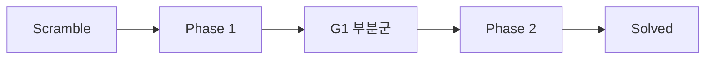
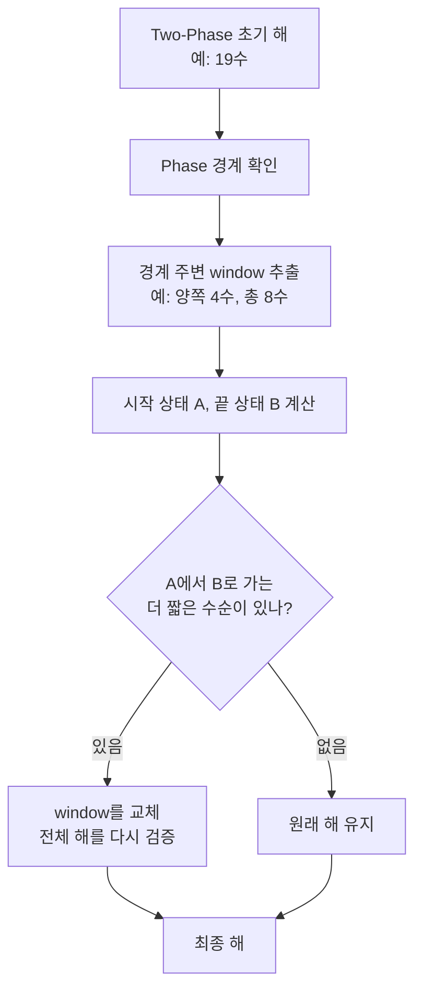

# 설계 노트

Phase-Boundary Exact Repair(rephase)가 어떤 생각에서 나왔고 코드의 어디에 들어 있는지 정리한 문서이다.

초기에 정리해 둔 설계 메모 PDF 2종(Kociemba 버전, stemil 버전)을 바탕으로 했다. PDF에는 논의 과정이 그대로 섞여 있어 원본은 공개하지 않았고, **실제로 구현하고 측정한 내용만** 옮겼다.

> 수(move)는 HTM(half-turn metric)으로 센다. `R`, `R2`, `R'`는 모두 1수이다.

**목차**
[1. 문제의식](#1-문제의식) · [2. 경계 수선](#2-phase-boundary-exact-repair) · [3. sliding window](#3-sliding-window) · [4. 변환 기준 비교](#4-변환transformation-기준-비교) · [5. stemil과 함께 쓸 때](#5-stemil과-함께-쓸-때) · [6. 코드 위치](#6-설계가-코드의-어디에-있나) · [7. 가설과 실측](#7-설계-가설과-실제-측정)

---

## 1. 문제의식

Kociemba two-phase는 해를 두 단계로 만든다.



```
  Phase 1                 Phase 2
  R U F2 L ... D    |     R2 U D2 ...
                    ↑
              phase boundary
```

Phase 1이 끝나는 순간에는 코너 방향, 엣지 방향, E-slice 조건을 **반드시** 만족해야 한다. 그런데 전체 최단 경로가 꼭 그 부분군을 지나는 것은 아니다. 따라서 경계 근처에서 국소적으로 낭비되는 수가 생길 수 있다고 보았다.

---

## 2. Phase-Boundary Exact Repair

전체 큐브를 다시 최적 탐색하지 않고, **경계 주변의 짧은 구간만** 정확하게 다시 푼다.



1. Two-Phase로 초기 해를 구하고 Phase 경계의 위치를 기록한다.
2. 경계 주변의 window(4~10수)를 잘라 시작 상태 `A`와 끝 상태 `B`를 구한다.
3. `A → B`를 **더 짧게** 만드는 수순이 있는지 정확히 검색한다. 큐브 전체가 아니라 가까운 두 상태 사이만 보므로 비용이 작다. 한쪽에서만 `b^8`을 탐색하던 것이 양쪽에서 `2·b^4` 정도로 줄어든다.
4. 있으면 바꿔 끼우고 전체 해를 다시 검증한다. 없으면 그대로 둔다. 따라서 **수는 절대 늘어나지 않는다.**
5. 시간 예산을 미리 나눈다. 예를 들어 총 1000 ms 중 rephase는 최대 100 ms이다.

정확한 탐색 방식은 구현마다 다르다. `rephase/`(Python/C)는 양방향 BFS이고, `stemil-rephase/`(C++)는 미리 만든 변환 DB를 조회한 뒤 반대편을 깊이 우선으로 탐색해 중간에서 만난다.

**한계도 분명하다.** 전역 최적해를 보장하지 않는다. 최적해가 Two-Phase 경로와 완전히 다른 경로라면 국소 수선으로는 찾을 수 없다.

---

## 3. sliding window

경계 수선이 끝났는데 시간이 남으면, 해 전체에 window를 한 칸씩 밀면서 같은 검사를 한다.

```
해: m1 m2 m3 m4 m5 m6 m7 m8 ...
    [m1 ~ m6]            → 더 짧은 수순이 있나?
       [m2 ~ m7]         → ...
          [m3 ~ m8]      → ...
```

항상 작은 window부터 시도하고, 시간이 다 되면 마지막으로 검증된 해를 돌려준다.

---

## 4. 변환(transformation) 기준 비교

window를 큐브 상태가 아니라 "이 수순이 일으키는 순열·방향 변화" `T = A⁻¹B`로 표현하면, 같은 변환을 만드는 **더 짧은 수순**을 찾는 문제가 된다. 짧은 수순들의 변환을 미리 표로 모아 두면 검색 없이 조회만으로 바꿀 수도 있다.

C++ 구현(`stemil-rephase/`)은 이 표를 `--table-depth`(기본 4, 0~5)와 `--repair-memory-mib`(기본 64) 한도 안에서 만든다. 목표 변환에서 `길이 − table_depth`만큼 탐색해 표에서 만나는 수순을 찾는다.

---

## 5. stemil과 함께 쓸 때

- stemil은 큰 pruning table(약 2 GiB RAM)로 **전역 탐색 품질**을 높이고, rephase는 그 결과의 **국소 비효율**을 지운다. 서로 다른 축의 최적화이다.
- 원본 stemil의 pruning table은 **rephase 검색에는 쓰지 않는다.** 이 표들은 "G1까지 남은 거리", "G1 안에서 solved까지 남은 거리"를 추정하는 용도이다. solved가 아닌 상태 `B`로 가는 `A → B` 문제에는 그대로 해석할 수 없어서, rephase는 따로 작은 정확 검색으로 두었다.
- 시간 예산을 나눠 비교할 수 있다. 예를 들어 "Two-Phase 1.0초"와 "Two-Phase 0.9초 + rephase 0.1초"를 같은 조건에서 비교한다.
- 해 길이에 따라 시간을 조정하는 `--adaptive`도 구현했다. 해가 21수 이상이면 rephase 비율을 절반으로 줄이고, 18수 이하이면 두 배(최대 0.5)로 늘린다. 6방향 탐색과는 함께 쓸 수 없다.

---

## 6. 설계가 코드의 어디에 있나

| 설계 요소 | 구현 위치 |
|---|---|
| Kociemba + 경계 수선 (Python/C) | [`rephase/`](../rephase) |
| stemil + 경계·sliding 수선 (C++, 기본판 `stemil_rephase`) | [`stemil-rephase/src/repair.cpp`](../stemil-rephase/src/repair.cpp), [`solver.cpp`](../stemil-rephase/src/solver.cpp) |
| 6방향 동시 탐색, 후보 rephase (확장판 `stemil_rephase_6way`) | [`stemil-rephase/src/solver.cpp`](../stemil-rephase/src/solver.cpp)의 `solve_multi`, [`symmetry.cpp`](../stemil-rephase/src/symmetry.cpp) |
| 최적해 검증 (IDA\*, 6way 확장) | [`stemil-rephase/src/optimal.cpp`](../stemil-rephase/src/optimal.cpp) |
| 같은 seed 비교 도구 | [`stemil-rephase/compare/`](../stemil-rephase/compare) |

---

## 7. 설계 가설과 실제 측정

설계 단계에서는 "Two-Phase의 낭비가 경계 근처에 모여 있을 것"이라고 가정했다. 실제로 재어 보니 다음과 같았다.

- **전체 표본에서 rephase의 이득은 작았다.** 이전 100개 실험에서 rephase로 줄어든 큐브는 100개 중 2~3개(각 1수)였다. 이득의 대부분은 **6방향 동시 탐색**에서 나왔다 → [`REPORT-6way.md`](../stemil-rephase/REPORT-6way.md).
- **rephase가 성공한 큐브만 모으면 이득이 보인다.** 버전별 200건 비교에서 rephase 전후 평균은 rephase(kociemba 기반) 20.75 → 19.54, `stemil_rephase` 19.93 → 18.80, `stemil_rephase_6way` 18.59 → 17.52로, 모두 1.1~1.2수 줄었다. 위 이전 실험(무작위 표본)과 범위가 다르다. 성공 비율은 각각 0.31%, 0.96%, 0.24%였다 → [루트 README의 6장](../README.md#6-실험-결과).
- 대신 rephase가 성공한 큐브를 모아 비교하면, 6way의 해가 증명된 하한과 같은 경우가 200건 중 85건(42.5%)이었다 → [루트 README의 6장](../README.md#6-실험-결과).
- stemil README가 공개한 시간별 평균 해 길이(0.5초 20.17수, 1초 20.09수, 2초 19.96수, 5초 19.73수)는 **원본 저장소의 수치**이다. 이 프로젝트에서 잰 값이 아니다.
- 설계 메모에는 비슷한 구조의 공개 구현을 찾지 못했다는 취지의 서술이 있었다. 검색만으로는 증명할 수 없는 주장이라 여기에는 옮기지 않았다.
