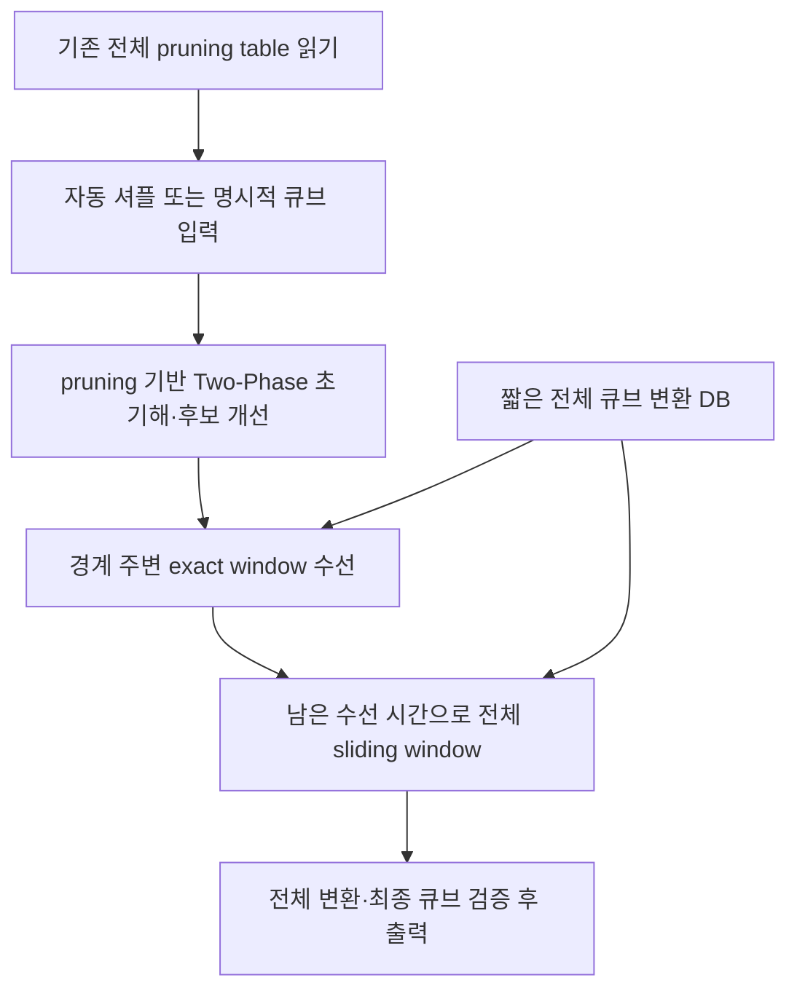

# stemil 자동 셔플·sliding rephase 업그레이드 결과

초기 업그레이드: 2026-09-17  
출력 단순화: 2026-09-22

## 2026-09-22 다중 stemil·rephase 추가

- `--stemil-max-ms 500,1000,2000`으로 동일 큐브에서 stemil을 여러 시간 조건으로 독립 실행할 수 있다. 시간이 늘어난 실행은 같은 결정적 탐색 순서를 더 오래 따라가며 더 짧은 후보를 찾을 수 있다.
- 다중 stemil과 다중 rephase를 함께 지정하면 stemil 조건을 모두 실행한 뒤 설정 시간이 가장 큰 stemil 초기해 하나에만 rephase를 적용한다. 모든 조건은 같은 seed와 셔플을 사용한다.
- Rephase는 `window × 최대시간 × 최소시간`의 전체 곱집합을 독립 실행한다. 예를 들어 3×3×2이면 window마다 6회, 전체 18회다.
- 사람용 출력과 JSONL은 각 stemil/rephase 결과가 끝나는 즉시 한 건씩 flush한다. JSONL은 `result_type`으로 두 결과를 구분한다.
- Stemil 출력에 최종 Phase 1·Phase 2·전체 solve의 move와 move 수, 누적 탐색 시간, phase 전용 테이블 메모리와 전체 peak RSS를 추가했다.
- 자동 solve는 `--seed`를 생략하면 실행할 때마다 새로운 무작위 seed를 만든다. `--seed`는 재현 시험에만 선택적으로 사용한다.
- `--windows 6,7,8 --rephase-max-ms 100,200,300`은 stemil 초기해를 한 번 구한 뒤 각 window에 100·200·300 ms 상한을 모두 적용해 9회 독립 실행한다. 어느 실행의 결과도 다음 실행의 입력으로 쓰지 않는다.
- 최대·최소 시간 목록은 모든 window와 서로 조합한다. 최소시간이 최대시간보다 큰 조합은 입력 오류로 거부한다.
- `--rephase-min-ms`는 exact window 탐색의 최소 배정 slice다. 최단거리 증명이 먼저 끝났을 때 시간을 채우기 위한 대기는 하지 않는다.
- 기본 출력에 셔플, stemil 해, rephase 해의 HTM move 수를 추가했다. 다중 모드에서는 각 window의 설정·move 수·단축 여부·단축 수·시간·메모리를 별도 블록으로 출력한다.
- 다중 모드의 `--budget-ms`는 stemil에 전부 주고 각 rephase 최대 시간은 이후 독립 예산으로 더한다. 기존 `--rephase-ms` 결합 모드는 그대로 지원한다.

설계 노트([docs/design.md](../docs/design.md))의 경계 exact repair에 설계 노트([docs/design.md](../docs/design.md))의 전체 sliding-window 수선을 추가했다. 기존 `third_party/stemil` 소스와 준비된 전체 pruning table 네 개를 읽기 전용으로 재사용한다. 변경한 코드는 현재 `stemil_rephase`에만 있다. 원본 소스·`a.out`·사용자 `instrumented/`·테이블은 수정하지 않는다.

이전 구현과 문서는 `reports/pre-sliding-source/`에 보존했다. `reports/sliding-upgrade.patch`는 해당 백업과 비교한 구현·CLI·문서 변경을 담고 있으며, 원본 stemil 파일은 포함하지 않는다. 이전 compact 사본과 캐시는 다시 만들지 않았다.

## 변경한 동작

1. **자동 셔플:** 인수 없는 실행이나 `solve`만 실행하면 매번 새 seed로 25수 셔플을 만들고 풀이한다. 실제 셔플·seed·길이를 결과에 남긴다. `--scramble-length`, `--seed`, `--runs`를 추가했다. `--runs`는 같은 프로세스에서 테이블을 한 번만 로딩하고 seed+i의 큐브들을 차례로 푼다. 명시적 scramble/facelet과 batch 입력도 유지한다.
2. **사용자 window:** 기본 길이를 4·6·8·10으로 바꾸고 단일 `--window`와 목록 `--windows`를 지원한다. 기존 결합 모드는 작은 순서로 정렬하고 중복을 제거하며, 다중 모드는 시간 목록과 대응하도록 입력 순서를 유지한다. 길이는 2..10이고, 해가 더 짧으면 해 전체로 줄인다.
3. **두 수선 단계:** 경계를 가로지르는 구간을 먼저 검사한 뒤 전체 해의 모든 시작 위치를 sliding으로 검사한다. `boundary+sliding`, `boundary`, `sliding` 모드를 선택할 수 있다. 교체 후 작은 구간부터 다시 검사하며, `--no-repeat`이면 첫 성공 교체에서 멈춘다.
4. **명시적 수선 시간:** `--rephase-ms`로 총 탐색 예산 안에서 수선 시간을 예약한다. 1000 ms 총 예산과 100 ms 수선이면 Two-Phase는 900 ms다. 초기 탐색이 일찍 끝나도 지정한 수선 상한은 늘리지 않는다. 0 ms는 수선을 비활성화한다. 기존 비율·adaptive 배분도 유지하지만 고정 ms와 동시에 지정하면 오류로 안내한다.
5. **경계/sliding 배분:** 기본 `--boundary-fraction 0.5`로 경계가 수선 예산의 최대 절반을 쓰고 sliding이 나머지를 받는다. 경계가 일찍 끝나면 남은 시간을 sliding에 넘긴다. 단독 모드는 전체 수선 예산을 사용한다. 구간별 `--window-slice-ms`도 유지한다.
6. **Trace와 통계:** `--trace`로 stderr JSONL, `--trace-file`로 새 파일 JSONL을 기록한다. 최초 해, 후보 개선, 단계 시작/끝, 구간 시작/끝, 실제 교체, timeout과 cache hit를 기록한다. 상세 결과 JSON은 `--json`으로 선택한다.
7. **탐색 결과 재사용:** 전체 변환의 lossless key와 strict 길이 상한으로 완료된 exact 결과를 최대 256개 재사용한다. Timeout은 부정적 결과로 저장하지 않는다. 경계에서 검사한 구간을 sliding에서 다시 만날 때 중복 탐색을 줄인다.
8. **끝 경계 처리:** 경계가 해의 끝일 때 구간 시작 범위가 비어 있던 경우를 수정했다. 끝에 붙은 window도 검사하며 `U F R R'`의 끝 경계를 `U F`로 수선하는 회귀 검증을 추가했다.
9. **순차 기본 출력:** stemil Phase 1·Phase 2·전체 해와 rephase 결과를 완료 즉시 출력한다. 테이블 로딩 진행 메시지는 숨기고 상세 결과는 `--json` JSONL로 제공한다.

| 변경 파일 | 역할 |
|---|---|
| `src/shuffle.hpp/.cpp` | seed와 합법적인 무작위 move 셔플 생성 |
| `src/repair.hpp/.cpp` | 경계 후 sliding, 시간 배분, 완료 결과 cache, 구간·단계 통계 |
| `src/trace.hpp` | 탐색 이벤트와 callback 정의 |
| `src/solver.hpp/.cpp` | 고정 rephase 상한, 총 deadline 공유, 초기 탐색 trace |
| `src/main.cpp` | 자동 실행·반복·window·시간·trace CLI, JSON 확장 |
| `tests/test.cpp`, `tests/cli_test.py`, `Makefile` | 구간·시간·CLI 검증 및 빌드 |
| `tools/benchmark.py`, `tools/postprocess.py` | 두 수선 방식 비교와 동일 초기해의 수선 효과 분리 |
| `README.md` | 새 실행법·옵션·결과 설명 |

## 기존 pruning과 exact repair의 연결

기존 stemil commit은 `5437b8f6f5c10b6da1857d4bf1d93000ba393063`이다. 원본 좌표·move 소스, pruning 배열·lookup, `phase1_search`를 그대로 사용한다. Phase 2는 기존 세 pruning projection 거리의 최댓값을 사용한다. 이 폴더의 adapter가 내부 deadline, 첫 move sentinel, 초기해·경계를 관리한다. 원본 파일은 패치하지 않으며 기존 `a.out`과 모든 후보·결과가 동일하다고 주장하지 않는다.



수선 대상 window의 permutation/orientation 전체 변환을 계산하고 Identity 기준 짧은 변환 DB와 역방향 제한 탐색으로 더 짧은 동치 sequence를 찾는다. 기본 DB는 깊이 4 이하 46,741 상태, 상주 table 4 MiB, 구성 중 table+queue 6,812,640 bytes다. 이 DB는 초기해의 pruning table을 대체하지 않는다.

교체는 길이가 엄격히 줄어들고 전체 sequence의 변환이 보존될 때만 적용한다. 최종 해를 실제 입력 큐브에 적용해 다시 검증한다. 수선 후 해가 Two-Phase 구조를 유지할 필요는 없으며 `final_focal_index`는 다음 경계 구간 선택의 중심이다.

원본 네 pruning 배열의 논리 크기는 2,181,911,040 bytes(약 2.03 GiB)다. ASCII 테이블 로딩과 DB 구성 시간은 `setup_ms`로 분리하고, `--budget-ms`는 초기화 이후 한 큐브의 탐색 시간이다. `--runs`와 `batch`로 로딩을 한 번만 할 수 있다.

## 실행 예제

```bash
cd <repo>/stemil-rephase
make -j2

# 매 실행 새 25수 셔플, 총 1초, 수선 최대 100 ms
./build/stemil-rephase

# 옵션을 명시하고 trace 표시
./build/stemil-rephase solve \
  --scramble-length 25 --windows 4,6,8,10 \
  --budget-ms 1000 --rephase-ms 100 --trace

# 같은 무작위 셔플과 stemil 초기해에 독립 rephase 9개 실행
./build/stemil-rephase solve \
  --windows 6,7,8 --budget-ms 1000 \
  --rephase-max-ms 100,200,300 --rephase-min-ms 10

# 동일 셔플 재현, 단일 8수 구간, 총 2초 중 수선 300 ms
./build/stemil-rephase solve \
  --seed 2026 --window 8 --budget-ms 2000 --rephase-ms 300

# 테이블 한 번 로딩, 셔플 3개, trace는 새 파일
./build/stemil-rephase solve --seed 2026 --runs 3 \
  --json --rephase-ms 100 --trace-file results/my-run.trace.jsonl \
  > results/my-run.jsonl

./build/stemil-rephase --help
```

`make: Nothing to be done for 'all'.`은 이미 최신 빌드라는 뜻이므로 solver를 실행하면 된다. Trace 파일은 덮어쓰지 않으므로 같은 이름이 존재하면 새 이름을 지정한다. 원본 stemil 디렉터리에는 trace를 저장할 수 없다. 기본 실행에서는 테이블 로딩 진행 메시지를 표시하지 않는다.

다중 모드의 `--json`은 stemil과 rephase가 끝날 때마다 독립 JSONL 행을 출력한다. Stemil 행의 `phase1_*`, `phase2_*`는 최종 해의 경계 기준 move와 전체 탐색 중 각 phase 함수에 누적된 시간이다. Rephase 행의 `initial_sequence/initial_htm`은 설정 시간이 가장 큰 stemil의 해다. Trace의 `initial_solution`은 최초로 찾은 해이므로 후보 개선 후의 최종 stemil 해와 다를 수 있다.

## 기능 검증

탐색·수선 구현은 `make test`, `make test-cli`, `make sanitize`를 통과했다. 2026-09-22의 다중 stemil·rephase 추가 후에는 `make test`와 `make test-cli`를 다시 실행해 통과했다. 기존 sanitizer 실행은 전체 pruning 데이터를 실제로 읽어 AddressSanitizer·UndefinedBehaviorSanitizer·LeakSanitizer로 검사했다. 다중 실행 변경 뒤 sanitizer는 반복하지 않았으며, 원본 pruning의 얕은 BFS 거리, cube 그룹·facelet·좌표 호환, exact window 최소거리, deadline·메모리 상한, 30개 end-to-end 풀이 검증은 단위 테스트로 다시 통과했다.

새로 검증한 항목은 다음과 같다.

- 새 seed/셔플 자동 생성, 고정 seed 재현, 25수 canonical 셔플, `--runs 3`의 seed 2026·2027·2028.
- 동일한 stemil 초기해에서 window 6·7·8을 독립 실행하고 각 최대 시간과 공통/개별 최소 시간의 위치 대응을 확인.
- 각 독립 결과를 54-sticker 모델로 다시 적용해 solved 상태와 초기해 이하 HTM을 확인.
- 동일 셔플에서 stemil 100·200 ms 조건을 순차 출력하고 200 ms 결과에만 rephase가 적용되는 조건을 확인.
- window 6·7·8, 최대시간 2·3·4 ms, 최소시간 0.5·1 ms가 각 window 6회씩 총 18개 조합을 만들고 같은 기준해를 사용하는지 확인.
- Phase 1·2 move 결합이 전체 stemil 해와 같고, phase 시간·전용 테이블 메모리가 기록되는지 확인.
- 실제 자동 생성 큐브 5개 모두 해결, 셔플이 만든 facelet과 초기·최종 해를 독립 sticker 모델로 확인.
- 단일/다중 window, 정렬·중복 제거, 옵션 범위·시간 배분 충돌·NaN 입력 오류.
- 경계에서 먼 구간의 sliding 교체와 엄격한 길이 감소, 반복 중단, 단계별 통계, 완료 결과 cache 공유.
- 고정 rephase 3 ms를 지정했을 때 초기 탐색 상한 97 ms, 초기 탐색이 일찍 끝나도 수선 시간이 확장되지 않는 조건.
- 0 ms 수선은 repair engine 없이 동작, 끝 경계 adjacent window 수선, 임의 sequence 20개의 splice 변환 보존.
- stdout/stderr JSON 분리, trace 파일 JSONL, 기존 trace 파일 보존, 원본 stemil 경로에 trace 쓰기 거부.

경계 외 수선 재현 예제는 다음과 같다. Window `[0,4)`의 `R R' U F`를 `U F`로 바꿔 7수 전체 변환을 5수로 보존한다. 같은 길이의 경계-only 검사에서는 이 구간을 선택하지 않는다.

```bash
./build/stemil-rephase repair \
  --sequence "R R' U F L B D" --boundary 7 \
  --window 4 --rephase-ms 100 --trace
# 최종 sequence: U F L B D, 7 -> 5 HTM, stage: sliding
```

Trace의 실제 `repair_applied` 이벤트, 독립 동치성 검증과 stage 통계는 `results/sliding-upgrade/cli-verification.json`에 있다. 단위/CLI 로그는 `unit-tests-final.log`, `cli-tests-final.log`에 보존했다.

## 측정 조건과 해석

균등 legal cube 100개 입력은 이전 비교와 동일한 `results/uniform-100/corpus.jsonl`을 사용한다. 자동 셔플 기능 검증은 새로 생성한 move 셔플을 사용하고, 성능 비교는 고정 facelet corpus를 사용한다. 각 설정은 별도 프로세스이며 모든 초기·최종 해를 독립 54-sticker 정수 회전 모델로 검증한다. 비교 기준은 이 adapter의 rephase 없는 실행이며 원본 `a.out` 자체의 측정은 아니다.

빌드·검증과 일부 겹친 첫 측정은 `results/sliding-upgrade/preliminary-uniform-100/`에 따로 보존한다. 최종 성능 표에는 검증 종료 후 겹치는 작업 없이 재측정한 결과를 사용한다. 같은 초기해에 수선만 적용하는 실험은 시간 제한 초기 탐색의 변동과 수선 자체의 효과를 구분한다.

### 동일한 총 1000 ms 예산

| 방식 | Two-Phase / 수선 상한 | 해결 | 초기 평균 HTM | 최종 평균 HTM | 단축 사례 / 수수 | 평균 탐색 시간 | 최대 탐색 시간 |
|---|---|---:|---:|---:|---:|---:|---:|
| 수선 없음 | 1000 / 0 ms | 100/100 | 19.85 | 19.85 | 0 / 0 | 1000.01 ms | 1000.04 ms |
| 경계 수선 | 900 / 100 ms | 100/100 | 19.85 | 19.82 | 3 / 3 | 963.87 ms | 977.60 ms |
| 경계 + 전체 sliding | 900 / 100 ms | 100/100 | 19.87 | 19.84 | 3 / 3 | 999.94 ms | 1000.09 ms |

경계와 경계+sliding 모두 index 3·39·43의 초기해를 각각 1수 단축했다. 이번 100개에는 sliding에서 추가로 줄어든 해가 없었다. 경계+sliding 실행에서는 index 15·83의 초기해가 기준의 20수에서 각각 21수로 달라져 최종 평균이 19.84수가 되었다. 같은 900 ms 상한에서도 시간 제한 후보 탐색이 방문하는 node 수와 종료 시점이 달라질 수 있다. 기준 대비 경계-only는 3개가 짧고 97개가 같았으며, 경계+sliding은 3개가 짧고 95개가 같고 2개가 길었다.

경계-only 평균 수선 시간은 63.85 ms, 두 단계는 99.93 ms였다. 전체 sliding이 남은 예산을 사용했지만 이번 corpus에서 추가 이득은 측정되지 않았다. 이 표본으로 sliding이 일반적으로 유리하다고 주장하지 않는다. 경계 밖 수선의 동작은 위 7→5 HTM 재현 사례와 독립 그룹/CLI 검증으로 확인했다.

초기 테이블 로딩·DB 구성은 설정별 11.02~12.48초, peak RSS는 약 2.04~2.05 GiB였다. 탐색 예산보다 2 ms 이상 초과한 사례는 세 설정 모두 없었다. 원시 결과와 독립 검증 요약은 [uniform-100/summary.json](results/sliding-upgrade/uniform-100/summary.json)에 있다.

### 같은 초기해를 고정한 수선 비교

총 1000 ms 기준 실행이 만든 동일한 100개 해를 고정하고, 각각 최대 100 ms의 수선만 적용했다. 초기해를 새로 찾지 않으므로 위 총 1초 비교와 별도의 후처리 실험이다.

| 수선 방식 | 동일 초기 평균 HTM | 수선 후 평균 HTM | 단축 사례 / 수수 | 경계 교체 | Sliding 교체 | 평균 수선 시간 |
|---|---:|---:|---:|---:|---:|---:|
| 경계 | 19.85 | 19.82 | 3 / 3 | 3 | 0 | 62.82 ms |
| 경계 + sliding | 19.85 | 19.82 | 3 / 3 | 3 | 0 | 99.93 ms |

같은 초기해에서도 두 방식 모두 3개를 1수씩 줄였고 sliding의 추가 단축은 0건이었다. 두 방식의 최종 평균이 모두 19.82수인 점은 위 19.82/19.84 차이를 수선 자체의 추가 길이 증가로 해석할 수 없음을 보여 준다. 모든 후처리 해도 독립 sticker 모델로 검증했다.

재현 명령:

```bash
python3 tools/postprocess.py \
  --baseline results/sliding-upgrade/uniform-100/repair-0.jsonl \
  --budget-ms 100 --windows 4,6,8,10 --repair-mode boundary+sliding \
  --out results/my-frozen-comparison
```

수선이 성공하면 그 실행의 초기해보다 길어지지 않는다. 그러나 총 예산 일부를 수선에 배분하면 초기해를 개선할 시간이 줄기 때문에, 별도 실행한 수선 없는 기준보다 항상 짧다고 보장하지 않는다. 구간 timeout은 최소성 증명이나 더 짧은 해가 없다는 증거가 아니다. Window의 정확한 최소거리 검색은 전체 큐브의 global optimal 보장이 아니며, 이번 uniform corpus의 전체 최소거리는 알려져 있지 않다.

`--budget-ms`와 구간 상한은 OS scheduling·node 사이 시간 확인이 적용되는 soft deadline이다. Trace 출력 비용도 탐색 시간에 포함된다. 프로그램 시작부터 첫 응답까지의 시간에는 `setup_ms`를 더해야 한다.

## 원본 보존과 결과 파일

작업 전후 원본 31개 파일을 대조해 수정·삭제·신규 생성이 없음을 확인했다. 작은 파일은 SHA-256과 크기·mtime/ctime, 두 대형 pruning 파일은 크기·mtime/ctime을 비교하며 atime은 읽기 동작으로 바뀔 수 있어 비교하지 않는다. 신규 파일도 검사한다. `results/sliding-upgrade/upstream-check.json`에 결과를 기록한다. 기존 stemil 안에서 빌드·테이블 생성·변환·출력 저장을 수행하지 않는다.

현재 기능 검증과 측정 자료는 `results/sliding-upgrade/`에 모았다. 환경·source/binary checksum은 `environment.json`, 검증 요약은 `verification.json`, CLI 실제 출력·trace는 `cli-verification.json`이다. 상세 옵션과 입력 형식은 [README.md](README.md)에 있다. 이전 전체 pruning 경계 수선 결과는 [reports/pre-sliding-source/REPORT.md](reports/pre-sliding-source/REPORT.md), 이전 compact 실험은 [reports/compact-experiment.md](reports/compact-experiment.md)에 별도로 보존했다.
